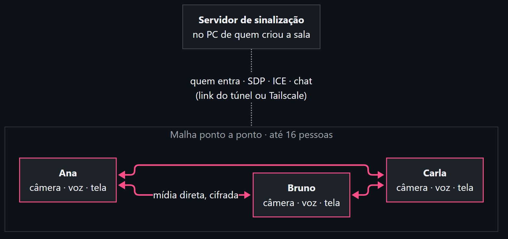
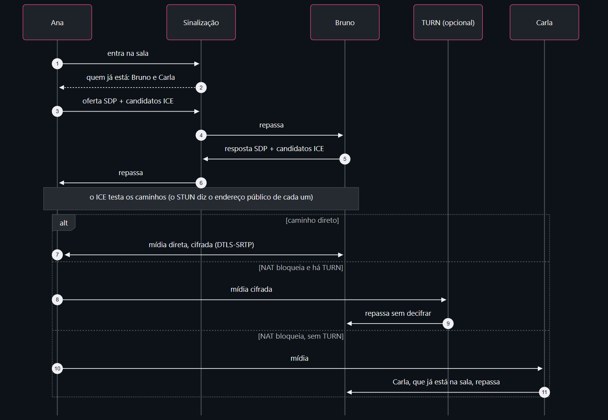

# Conexão, voz e relé

O Vcall liga cada pessoa direto nas outras, sem servidor de mídia, e por isso a
chamada é criptografada de ponta a ponta. Esta página explica o que ele faz para
a voz não picotar e a chamada não cair.

## Como a chamada funciona

O servidor roda no computador de quem criou a sala, e os outros chegam a ele
pelo link (túnel do Cloudflare) ou pelo Tailscale. Ele só apresenta as pessoas:
quem entra, as ofertas e respostas de conexão (SDP), os caminhos possíveis (ICE)
e o texto do chat, sem guardar nada. Câmera, voz, tela, quadro e arquivos vão
direto de um computador ao outro, criptografados (DTLS-SRTP).

Cada pessoa manda uma cópia da própria câmera para cada uma das outras. Por isso
a sala vai até 16 pessoas, e o Vcall baixa a qualidade sozinho conforme ela
enche.

Quando a conexão direta não fecha, a mídia passa por um [servidor TURN](#servidor-turn),
se houver um configurado, ou por outra pessoa da sala ([relé](#relé-a-sala-se-ajuda)).

## Voz que aguenta rede ruim

- **Redundância (RED):** cada pacote de voz leva junto uma cópia do anterior. Se
  um pacote se perde no Wi-Fi ou no 4G, o seguinte cobre o buraco na hora, sem
  esperar reenvio.
- **FEC do Opus:** o próprio codificador de voz manda um resumo do trecho
  anterior. Perdas isoladas somem sem ninguém notar.
- **DTX:** quem está calado quase não manda nada. Numa sala cheia, quase todos
  estão calados, e cada pessoa a mais pesa bem menos.
- **Som da tela em estéreo**, para música e vídeo compartilhados.

## Relé: a sala se ajuda

Com três pessoas ou mais, quem está na chamada vira caminho reserva.

- **Resgate.** Se a conexão direta entre duas pessoas cai, alguém ligado às duas
  passa a repassar voz, câmera e tela entre elas em cerca de três segundos. A
  conexão direta continua tentando voltar por baixo e, quando volta, cada um
  volta a receber direto.
- **Ajuda a quem tem internet fraca.** Quem tem pouca subida, ou está no celular
  numa sala de quatro pessoas ou mais, manda câmera e tela uma vez só, para um
  computador forte da sala, que repassa para os outros. A voz continua direta,
  sem atraso a mais.

Quem ajuda é escolhido sozinho: computador (não celular), com 4 núcleos ou mais.
Cada ajudante atende no máximo uma pessoa por par de núcleos. Com mais gente
forte na sala, mais gente pode ser ajudada.

Quem manda só desliga o envio direto depois que o ajudante confirma que está
repassando, então não há um instante sem caminho. Se o ajudante sai, tudo volta
para o direto.

O repasse passa pelo computador de quem ajuda. Ele decodifica e codifica de
novo a imagem e a voz, porque o navegador não deixa encaminhar pacotes de outro
jeito. A criptografia vale em cada trecho, mas o ajudante recebe a mídia que
repassa, como qualquer participante da chamada.

## Quedas que o navegador demora a perceber

- **Troca de rede** (Wi-Fi para 4G, cabo que sai): o Vcall refaz a ligação de
  todas as conexões na hora, em vez de esperar o navegador notar. A mídia segue
  pelo caminho velho até o novo ficar pronto.
- **Conexão congelada:** se uma conexão diz "conectada" mas fica dez segundos sem
  receber nada, ela é refeita.
- Continuam valendo os reinícios automáticos e, com servidor TURN configurado, a
  passagem por ele quando a conexão direta não fecha (veja `TURN.md`).

## Servidor TURN

Quando duas pessoas não conseguem conexão direta (4G com CGNAT, Wi-Fi de
empresa, faculdade ou hotel), um servidor TURN repassa a chamada. A mídia
continua criptografada: ele não tem as chaves. Ele só entra quando a conexão
direta não fecha, e resolve também a chamada a dois, onde o relé não tem a
quem pedir ajuda.

No app de computador: **Configurações › Servidor TURN**.

1. Escolha o tipo:
   - **Link de um provedor**: crie uma conta grátis na
     [Metered](https://www.metered.ca/tools/openrelay/) (20 GB por mês), crie
     uma credencial e cole o link
     `https://SEUAPP.metered.live/api/v1/turn/credentials?apiKey=…`.
   - **Meu servidor coturn**: os endereços (`turn:` e `turns:`) e o segredo
     (`static-auth-secret`). Como montar um de graça: [TURN.md](https://github.com/victor-kauan-coder/Vcall/blob/main/TURN.md).
   - **Usuário e senha**: para servidores que só têm isso.
2. **Salvar** e depois **Testar**. "Funcionando" quer dizer que o servidor
   autenticou e entregou um caminho de repasse.

A senha e o segredo ficam só neste computador (no arquivo `turn.json` da pasta
do app) e não voltam para a tela. Para trocar, salve de novo; com o campo vazio,
o que estava salvo continua.

Rodando o servidor pelo código (`npm start`), use as variáveis do `.env` em vez
disso: veja `TURN.md`.
