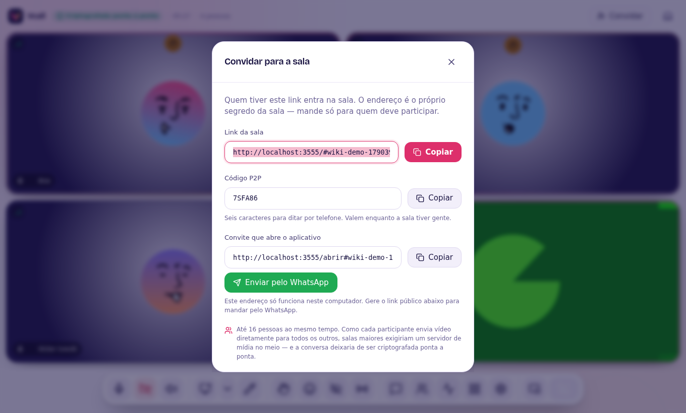
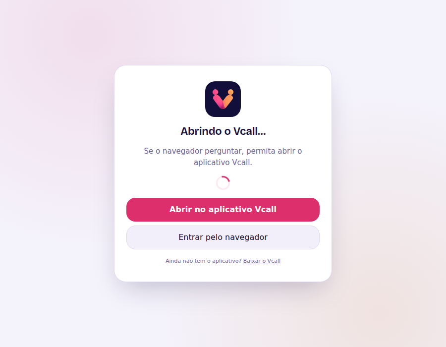

# Convidar e WhatsApp

Clique em **Convidar**, no canto de cima.

| Opção | Quando usar |
| --- | --- |
| **Link da sala** | Mandar por qualquer lugar; abre no navegador |
| **Código P2P** | Ditar por telefone: seis letras, sem letras parecidas (0/O, 1/I/L) |
| **Convite que abre o aplicativo** | **WhatsApp**, Telegram, e-mail: abre direto no app de quem tem o Vcall |
| **Link público pela internet** (app) | Para quem está fora da sua rede |
| **Pela sua rede Tailscale** (app) | Para quem está na sua tailnet: privado e com HTTPS. Veja [Tailscale](Tailscale) |

## Enviar pelo WhatsApp

1. No aplicativo, clique em **Gerar link** em "Link público pela internet"
   (a primeira vez baixa o `cloudflared`, uma vez só).
2. Clique em **Enviar pelo WhatsApp**. O WhatsApp abre com a mensagem pronta.

A mensagem leva um **link curto**, `https://…/c/ABC123` (o código da sala).
No WhatsApp ele vira um **cartão**, como o de um vídeo do Instagram: a imagem
da marca, o nome da chamada, quem chamou e "Toque para entrar".

A mensagem é **só o link**, sem texto junto: assim o WhatsApp mostra só o
cartão, sem o endereço escrito, como um Reels do Instagram. Embaixo do cartão
aparece só o domínio. Se você escrever algo antes do link, o WhatsApp volta a
mostrar o endereço inteiro: mande o texto numa mensagem separada.

O cartão só aparece com o link público (Cloudflare), porque o WhatsApp
precisa abrir o endereço para montar a prévia. Pelo Tailscale o link funciona
igual, sem cartão. O link de uma chamada que já acabou avisa que ela acabou.

O link é **clicável** (links `vcall://` não são). Ao clicar:

- **no computador com o Vcall instalado:** o navegador pergunta "Abrir o
  Vcall?" e a chamada abre no aplicativo;
- **no computador sem o Vcall:** a página oferece **Entrar pelo navegador** ou
  **Baixar o Vcall**;
- **no Android com o app Vcall:** a chamada abre direto no aplicativo, sem
  perguntar nada;
- **no Android sem o app, no iPhone:** vai direto para a chamada no navegador.

> O link público muda toda vez que o túnel é reaberto. Um convite antigo para
> de funcionar quando você fecha o Vcall.

## Salas com senha

Quem entra pelo link precisa digitar a senha. Ela é conferida no servidor,
nunca guardada em claro, e tentativas erradas em sequência bloqueiam o
endereço por um tempo.
