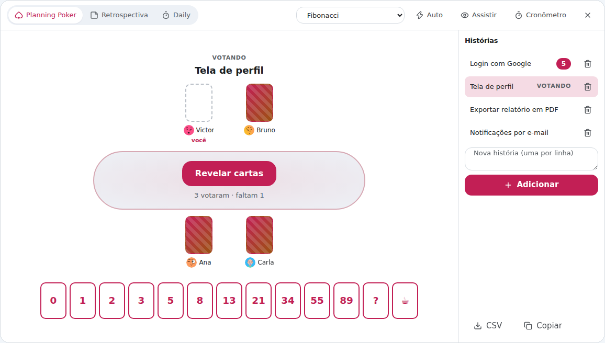
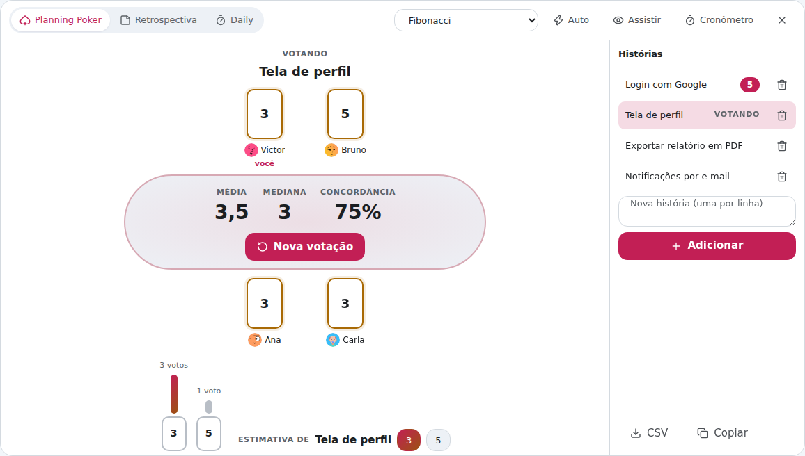
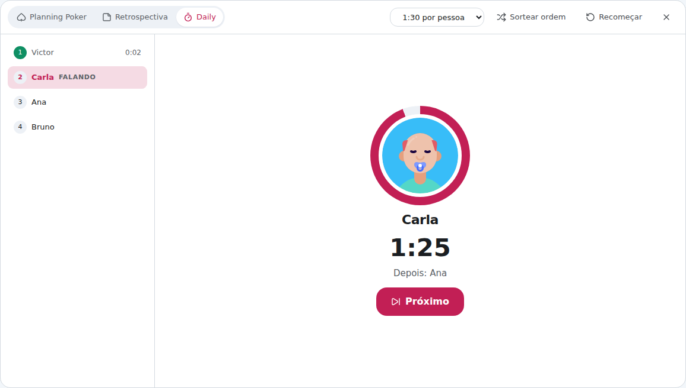

# Jogos de equipe

Três rituais de Scrum dentro da própria chamada, sem abrir outro site, sem
conta e sem convite extra: **Planning Poker**, **Retrospectiva** e **Daily**.
Todo mundo que está na sala já está na mesa.

Para abrir: botão **🎲 Jogos de equipe** na barra (ou tecla **`K`**). Quem
abre avisa a sala: os outros recebem *"Victor abriu o Planning Poker"* com o
botão **Participar**. Os vídeos continuam na faixa ao lado.

Fechar os jogos (o **X** no canto) fecha só para você, e o jogo continua para
os outros. Quem entra no meio recebe tudo como está: histórias, votos já
revelados, notas e a ordem da Daily.

## Planning Poker

1. **Histórias**: escreva na lista ao lado e tecle Enter. Dá para colar várias
   de uma vez, uma por linha. Clique numa história para votar nela.
2. **Votar**: escolha uma carta. Clicar de novo na mesma carta tira o voto.
   Os outros veem só que você votou (o verso da carta), nunca o valor.
3. **Revelar cartas**: qualquer pessoa revela. Uma contagem curta (3, 2, 1) e
   as cartas viram para todos ao mesmo tempo.
4. **Resultado**: média, mediana, concordância e um gráfico de quantos votaram
   em cada carta. A carta menor e a maior ficam destacadas, para quem votou
   nelas explicar o porquê. Se todo mundo votou igual, tem confete.
5. **Salvar a estimativa**: clique numa das cartas sugeridas (a destacada é a
   mais perto da média). A estimativa vai para a história e a mesa passa
   sozinha para a próxima.

### Opções da mesa

| Opção | O que faz |
| --- | --- |
| **Baralho** | Fibonacci, Fibonacci modificada (½, 20, 40, 100), Tamanhos de camiseta (PP a XGG), Potências de 2 e **Confiança** (punho de 5, para o voto de confiança no fim da sprint) |
| **Auto** | Revela sozinho quando todo mundo votou |
| **Assistir** | Você não conta na votação (bom para o PO ou o Scrum Master) |
| **Cronômetro** | 1, 2, 3 ou 5 minutos de discussão, o mesmo relógio para todos |
| **CSV / Copiar** | Leva as histórias com as estimativas para a planilha ou o Jira |

Passe o mouse sobre alguém na mesa e jogue um emoji 👏🎉😂🤔☕🔥: ele voa do
seu lugar até o da pessoa.

## Retrospectiva

Três fases, sempre iguais para todo mundo. Qualquer pessoa pode passar de uma
para a outra.

1. **Escrever**: cada um escreve nas colunas. **Ninguém lê a nota dos
   outros** nesta fase (aparecem borradas), para ninguém se influenciar. Em cima
   aparece quantas notas cada pessoa já escreveu.
2. **Votar**: as notas aparecem para todos. Cada pessoa tem **3 pontos** para
   distribuir (pode pôr mais de um na mesma nota). Os pontos dos outros só
   aparecem na discussão.
3. **Discutir**: os pontos aparecem, e as notas mais votadas sobem. Embaixo fica
   o **plano de ação**: escreva quem faz o quê e marque quando estiver feito.

Modelos: **Começar · Parar · Continuar**, **Bom · Melhorar · Ideias**, **4Ls**
(gostei, aprendi, faltou, desejei) e **Feliz · Triste · Bravo**. No fim,
**Copiar** ou **.md** levam a retrospectiva inteira em Markdown, pronta para a
wiki do time.

## Daily

**Sortear ordem** embaralha quem fala (sorteio de verdade, igual para todos).
**Começar a daily** liga o relógio: cada pessoa tem o mesmo tempo (1, 1:30, 2
ou 3 minutos), e o anel em volta do avatar esvazia. Faltando 15 segundos ele
fica laranja; estourou, fica vermelho, pulsa e conta o tempo a mais.

**Próximo** passa a vez (se duas pessoas clicarem juntas, avança uma vez só).
No fim aparece quanto durou a daily e quem passou do tempo.

## Privacidade e leveza

- Tudo vai pelo mesmo canal direto e cifrado do canvas, de computador para
  computador. Só se esse canal ainda não abriu com alguém a sinalização repassa
  a mensagem, sem guardar nada.
- **O voto fica no seu computador até alguém revelar.** Antes disso, os outros
  recebem só "votou". Na Retrospectiva é igual: o texto da nota só sai do seu
  computador quando a sala passa para a votação.
- O estado é um mapa que se junta sozinho (cada valor tem um relógio, e vence o
  mais novo). Mensagens fora de ordem ou repetidas dão o mesmo resultado em
  todo mundo.
- Nada fica rodando à toa: o painel só redesenha o que mudou, e o relógio de
  250 ms só liga durante uma contagem, um cronômetro ou a Daily.

## Atalhos

| Tecla | Ação |
| --- | --- |
| `K` | Abre ou fecha os jogos |
| `Enter` | Adiciona a história, a nota ou a ação |
| `Shift` + `Enter` | Quebra a linha numa nota |
