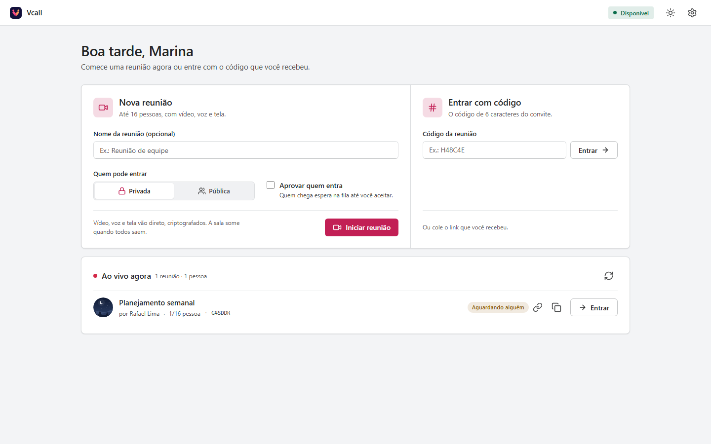
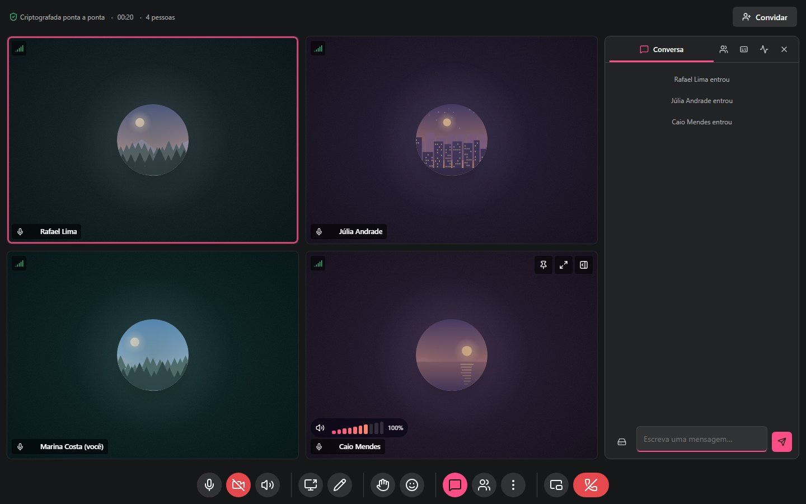

# Novidades da 3.16

## 3.16.0: o visual Empresa

O Vcall ganhou um segundo visual, sóbrio como o Teams e o Meet. Para trocar:
**Configurações › Aparência › Visual** e escolha **Vcall** ou **Empresa**. A
troca vale na hora, sem recarregar, e fica guardada neste computador.

- **Tela inicial**: **Nova reunião** e **Entrar com código** lado a lado, e as
  reuniões ao vivo numa lista embaixo.
- **Antes de entrar**: a câmera grande à esquerda; nome, aparelhos e avatar à
  direita.
- **Na chamada**: tudo fica escuro, inclusive a conversa, também no tema
  claro. Os botões são
  redondos e ficam vermelhos quando o microfone ou a câmera estão desligados.
  A conversa e as pessoas abrem num cartão ao lado.
- **Barra enxuta**: jogos, legendas, gravação, qualidade, layout e
  configurações ficam no botão **Mais** e voltam à barra enquanto estão
  ligados. Os atalhos de teclado continuam valendo.

A paleta (Tinta, Ametista, Carvão, Oceano, Brasa) e o tema claro ou escuro
valem nos dois visuais. No Empresa, a cor de destaque é a da paleta: o resto
da tela fica em cinza de escritório.

### Avatares de paisagem

No lugar dos rostinhos do estilo da casa, dez paisagens: montanhas, lago,
mar, floresta, dunas, colinas, neve, noite, aurora e cidade. **Sortear**
troca a hora do dia e o relevo sem trocar a cena. Elas valem nos dois
visuais; os outros estilos de avatar e a foto continuam lá.
