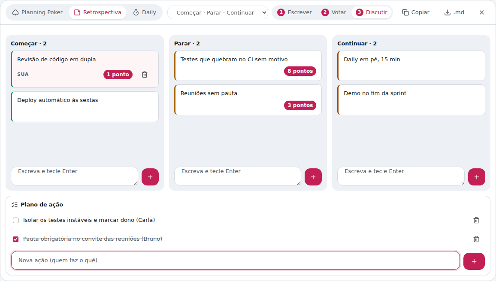

# Novidades da 3.8

## Jogos de equipe

**Planning Poker**, **Retrospectiva** e **Daily** dentro da chamada: botão 🎲
na barra ou tecla **`K`**. Quem abre avisa a sala, e os outros entram com um
clique. → [Jogos de equipe](Jogos-de-equipe)

- **Planning Poker**: votos escondidos até revelar, contagem 3-2-1, média,
  mediana, concordância e gráfico. Lista de histórias com estimativa salva num
  clique, CSV, cronômetro, revelação automática, modo espectador, emojis e
  cinco baralhos, incluindo o **voto de confiança** (punho de 5).
- **Retrospectiva**: escrever às cegas, votar com 3 pontos e discutir as mais
  votadas, com plano de ação. Quatro modelos e exportação em Markdown.
- **Daily**: ordem sorteada e o mesmo tempo para cada um, com o anel que
  esvazia em volta de quem fala.

## Câmera em HD

A imagem da câmera ficava presa na resolução escolhida nos primeiros
segundos da chamada, quando o navegador ainda acha que a internet é lenta. Com
banda de sobra, saía 640×360 a 960×540. Agora o Vcall percebe isso e faz o
codificador reavaliar: a câmera sobe para 1280×720 quando a rede permite.

## Tela compartilhada sem piscar

Com a tela parada, a imagem do outro lado sumia e voltava a cada 1–3 s: o
ladrilho confundia "sem quadro novo" com "câmera fechada" e mostrava o avatar.
Agora a tela segura a última imagem até a pessoa parar de compartilhar.

## Celular

Sozinho na sala, o canvas abria com 0 px de largura no celular. Corrigido.
