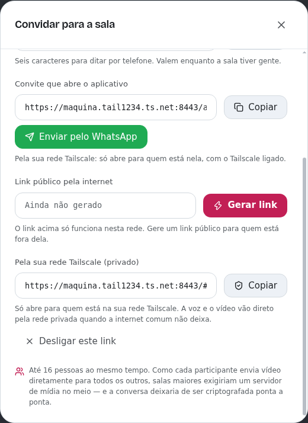
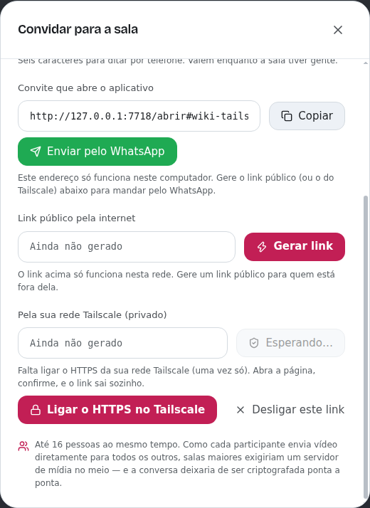
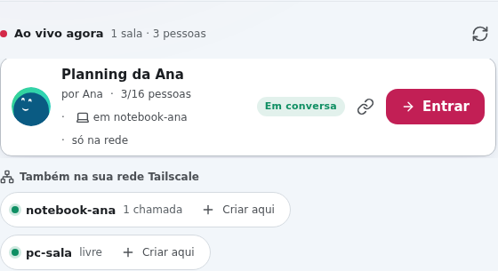

# Tailscale

Se você e as pessoas que você chama usam [Tailscale](https://tailscale.com),
o Vcall gera um link da sala que **só abre dentro da sua rede Tailscale**. A
voz e o vídeo passam a ter um caminho a mais pela sua rede privada.



## Quando ajuda (e quando não muda nada)

O Vcall já manda voz e vídeo **direto** de um computador para o outro. Na
maioria das casas esse caminho direto funciona, e aí ele é o melhor possível:
o Tailscale não deixa a imagem mais nítida nem a voz mais limpa.

Ele faz diferença quando o caminho direto **não acontece**:

- 4G/5G e provedores com CGNAT;
- redes de empresa, faculdade ou hotel;
- roteadores com NAT duplo (o modem da operadora mais o seu).

Sem um servidor TURN, nessas redes a chamada nem conectava. O Tailscale
acerta o caminho direto em muito mais redes, porque abre portas no roteador e
tem truques para NAT difícil. Quando nem ele consegue, usa os servidores DERP
dele, o que funciona mas com mais atraso.

Outras vantagens do link do Tailscale:

- **Privado:** só abre para quem está na sua rede (tailnet), não para qualquer
  um com o link.
- **Sem depender do Cloudflare:** o link é `https://seu-computador.sua-rede.ts.net`,
  com certificado de verdade. Não cai com os erros 530/1033 do túnel rápido.
- **Fixo:** é sempre o mesmo endereço enquanto o seu computador tiver o mesmo
  nome no Tailscale (só a sala muda).

> A "chamada ruim" que muita gente via até a 3.7 não era a rede: era a câmera
> presa em baixa resolução, corrigida na 3.8.0.

## Como usar

1. Instale o Tailscale em **todos** os computadores
   ([tailscale.com/download](https://tailscale.com/download)) e entre na mesma
   rede (a sua conta, ou convide as pessoas para a sua tailnet).
2. No Vcall de quem cria a sala: **Convidar › Pela sua rede Tailscale › Gerar link**.
3. Na primeira vez, se o HTTPS da sua rede estiver desligado, aparece
   **Ligar o HTTPS no Tailscale**. Abra, confirme na página do Tailscale e
   volte: o link sai sozinho, sem clicar de novo.

   

4. Mande o link (ou use **Enviar pelo WhatsApp**: sem link público aberto, o
   convite usa o do Tailscale). Quem recebe precisa estar com o Tailscale
   ligado. Pode abrir no navegador ou no app.

**Desligar este link** tira a sala da rede na hora. Fechar o Vcall também.

## Chamadas ativas na rede

Com o Tailscale ligado, a tela inicial do Vcall mostra em **Ao vivo agora** as
chamadas de **todos os computadores da sua rede** que estão com o Vcall
aberto. Cada uma diz em qual computador está ("em notebook-ana"), e
**Entrar** leva até ela. Embaixo, **Também na sua rede Tailscale** lista esses
computadores, com **Criar aqui** para abrir uma chamada em outro computador.



Quem aparece é o que cada pessoa escolheu ao criar a chamada:

| Ao criar | Quem vê na lista |
| --- | --- |
| **Privada** | Ninguém. Só entra quem tem o link ou o código |
| **Na minha rede** (padrão na rede) | Quem está na sua rede Tailscale. Quem chega pelo link público do Cloudflare não vê |
| **Pública** | Qualquer pessoa que abra a tela inicial daquele computador, inclusive pelo link público |

Um computador só aparece para os outros quando está **disponível na rede**:
com o link do Tailscale ligado no Convidar, ou com a opção abaixo.

## Criar chamadas pelo celular

O celular não hospeda a chamada: ela fica num computador com o Vcall. Com o
Tailscale, o celular cria a chamada num computador da rede a qualquer hora.

1. No computador: **Configurações › Rede Tailscale › Deixar este computador
   disponível na minha rede Tailscale**. O link do Tailscale passa a subir
   sozinho sempre que o Vcall abre, e o endereço aparece ali com **Copiar**.
2. No celular, com o Tailscale ligado, abra esse endereço
   (`https://seu-computador.sua-rede.ts.net/`):
   - **no app do Vcall:** cole o endereço completo (com `https://`) em "Link do
     convite" e toque em **Entrar**. Ele fica nos **Recentes** para as próximas
     vezes;
   - **no navegador:** é só abrir o endereço.
3. Aparece a tela inicial daquele computador: **Criar nova call**, e as
   chamadas ativas da rede para entrar com um toque.

Do celular também dá para usar **Criar aqui** nos outros computadores da lista.

## Como saber se a chamada está indo pelo Tailscale

Abra **Qualidade da chamada** (o gráfico na barra) e veja **Rota**:

| Rota | O que é |
| --- | --- |
| direta (P2P) | Caminho direto comum. É o melhor, e o Tailscale nem é usado |
| direta pela rede Tailscale | O caminho comum não passou, e a chamada foi pela sua rede privada |
| via servidor TURN | Passou por um servidor de retransmissão |

O Vcall não força o Tailscale. Os dois caminhos são testados ao mesmo tempo, e
o navegador fica com o caminho comum sempre que ele funciona.

## Requisitos e problemas comuns

| Mensagem | O que fazer |
| --- | --- |
| *O Tailscale não está instalado* | Instale e entre na sua conta |
| *O Tailscale está instalado, mas não está aberto* | Abra o Tailscale (ícone na bandeja/barra) |
| *Entre na sua conta do Tailscale* | Ícone do Tailscale › Log in |
| *Ligue o MagicDNS* | Painel do Tailscale › DNS › MagicDNS: é ele que dá o nome do link |
| *No Linux, o Tailscale só deixa o administrador publicar* | Rode uma vez: `sudo tailscale set --operator=$USER` |
| *Este Tailscale é antigo demais* | Atualize para a versão 1.52 ou mais nova |
| As portas 443, 8443 e 10000 em uso | Você já publica outras coisas no Tailscale; libere uma delas |

Se você já publica algo na porta 443 do Tailscale, o Vcall usa a 8443 (ou a
10000) e não mexe na sua configuração.

## Como funciona por dentro

- O app roda `tailscale serve --https=443 http://127.0.0.1:<porta>` **em
  primeiro plano**. A publicação pertence a esse processo: se o Vcall fechar
  ou cair, o Tailscale desfaz tudo sozinho.
- O link é conferido conectando direto no IP do Tailscale (com o nome no
  certificado), então funciona mesmo que o DNS deste computador ainda não
  conheça o nome. Na primeira vez o Tailscale emite o certificado, e isso leva
  alguns segundos.
- Quem entra pelo Tailscale chega ao servidor do Vcall vindo de `127.0.0.1`.
  O endereço real (100.x) vem no `X-Forwarded-For`, que o `tailscale serve`
  substitui, e o Vcall só aceita endereços da tailnet. O painel do anfitrião
  (que liga e desliga os links) continua invisível para quem vem de fora.
- A voz e o vídeo não passam pelo `serve`: vão de computador para computador.
  O Tailscale entra como mais uma "placa de rede" com endereço 100.x, e o
  navegador a usa quando o caminho comum falha.

- A lista da rede é montada pelo app de mesa: `tailscale status --json` diz
  quais computadores estão ligados, e cada um é perguntado (`/api/rooms`, nas
  portas 443, 8443 e 10000 ao mesmo tempo, com 2,5 s de prazo) se tem Vcall.
  Quem não tem fica 30 s sem ser perguntado. O que chega de cada computador é
  conferido campo a campo antes de aparecer na tela.
- `/api/rede` (a lista) e as salas **Na minha rede** só respondem para a
  própria máquina e para quem chega pela tailnet. Pelo túnel do Cloudflare,
  elas não existem.

### Servidor próprio (`npm start`)

Num servidor que roda o Vcall com Node, o mesmo vale à mão:

```bash
TRUST_TAILSCALE=1 npm start            # aceita o IP da tailnet no X-Forwarded-For
tailscale serve --bg --https=443 http://127.0.0.1:3000
```

O link fica `https://nome-do-servidor.sua-rede.ts.net/`.
